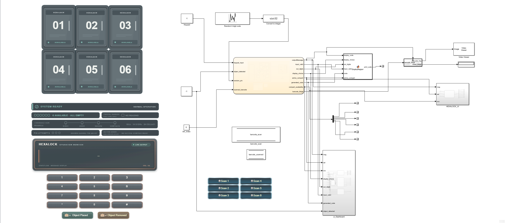
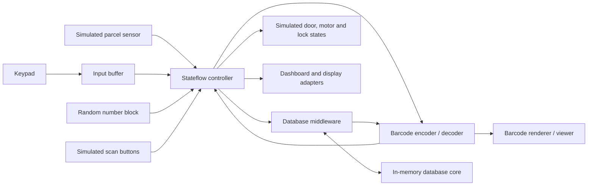
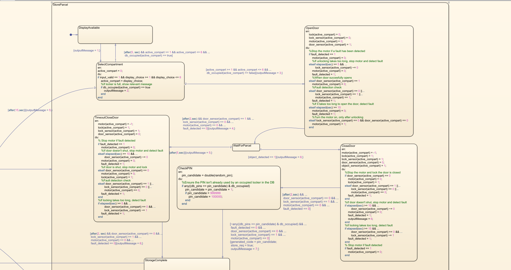
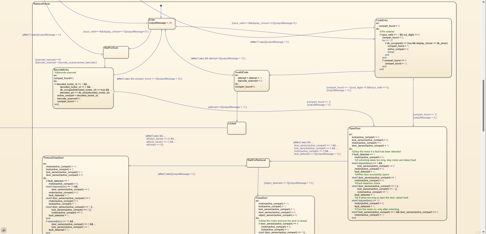
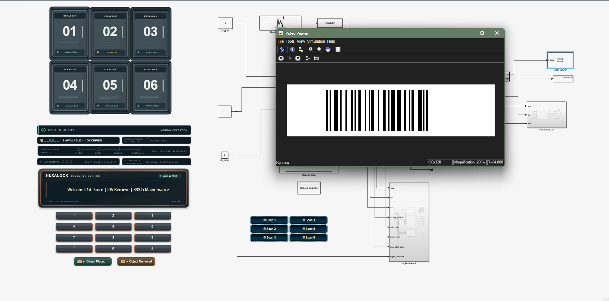
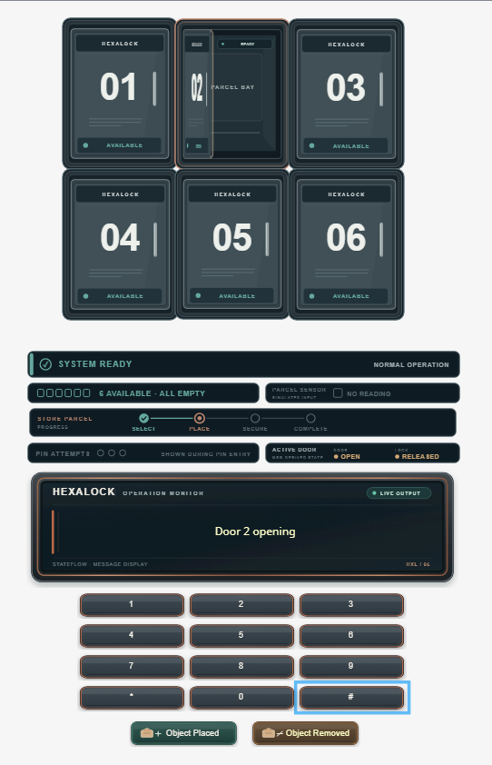

# HEXALOCK Smart Parcel Locker System

**A six-compartment embedded systems simulation for automated parcel storage, authenticated retrieval and maintenance management.**

    

<p align="center">
  <a href="./hexalock-dashboard.png"></a>
  <br>
  <em>Figure 1. HEXALOCK's interactive dashboard and top-level Simulink architecture.</em>
</p>

## Contents

[Overview](#1-project-overview) · [Features](#2-what-we-built) · [Design rationale](#3-problem-definition-and-design-rationale) · [Architecture](#4-system-architecture) · [Workflows](#5-operational-workflows) · [Authentication](#6-authentication-and-barcode-design) · [Challenges](#7-challenges-redesign-decisions-and-lessons-learned) · [Dashboard](#8-human-machine-interface) · [Verification](#9-verification-and-test-scenarios) · [Run locally](#10-running-hexalock) · [Limitations](#11-limitations-and-future-development) · [Team](#12-project-team)

## 1. Project overview

Parcel lockers allow deliveries to be stored and collected without requiring the sender and recipient to be present at the same time. However, a locker system must do more than open a door on request. It must know which compartments are available, associate a parcel with the correct collection credentials, control access, handle incomplete transactions and provide a way to recover from faults.

We developed HEXALOCK as an academic prototype to investigate how these requirements could be modelled as an integrated embedded system. Our objective was to bring together state-based control, data management, numerical authentication, simulated sensors and actuators, and a human-machine interface within a single Simulink model.

The project was developed collaboratively by six students at Swansea University for CSC368 — Embedded Systems Design (2026–2027).

## 2. What we built

- Six independently addressed locker compartments with availability tracking.
- Parcel storage and retrieval through a numerical keypad.
- Random six-digit PIN generation with active-PIN collision checking.
- Eight-digit barcode tokens rendered using Code 128C.
- Alternative retrieval using a PIN or a simulated barcode scan.
- In-memory compartment records and database middleware.
- Failed PIN attempt tracking, temporary lockout, transaction timeouts and fault-handling logic.
- Maintenance authorisation, individual compartment clearing and full system reset.
- An interactive dashboard with animated doors and parcels, status indicators, an operation monitor and masked PIN entry in the enhanced interface.

## 3. Problem definition and design rationale

### Why a parcel locker?

A parcel locker presents an interesting embedded engineering problem because the physical process, the user interaction and the stored data must remain consistent. A compartment cannot be considered free merely because its door is closed, and opening a compartment cannot be treated as a successful collection until the parcel has been removed.

Rather than model six independent buttons controlling six doors, we treated the locker as a transaction-based system. Each operation has a beginning, a sequence of guarded actions and a completion or recovery path.

### Why Simulink and Stateflow?

The locker is naturally event-driven: a keypad confirmation, a sensor event, an authentication result or a timeout determines the next action. Stateflow allows these behaviours to be represented as explicit states and guarded transitions instead of one long sequence of conditional statements. Simulink connects these controller decisions to the random-number source, barcode rendering, simulated inputs and visual outputs.

The separation also makes it easier to reason about what should happen if a user does not complete an operation or if the expected door and lock conditions are not satisfied.

## 4. System architecture



*Conceptual view of the logical components; the actual Simulink wiring is shown in Figure 1.*

| Component | Design responsibility |
|---|---|
| Input buffer | Accumulates digits, tracks input length, clears input and emits a confirmation event. |
| Main Stateflow controller | Coordinates storage, retrieval, maintenance, timeouts and fault recovery. |
| Database middleware | Converts controller requests into record operations and checks scanned tokens. |
| Database core | Maintains six-element arrays for occupancy, stored PINs, barcode tokens and lock status. |
| Barcode encoder and decoder | Convert between a locker/PIN pair and an eight-digit numerical token. |
| Barcode renderer | Produces a grayscale Code 128C image for display. |
| Dashboard subsystems | Translate controller messages and compartment states into visual feedback. |

### Why separate the controller and database?

The controller describes what the system is doing, while the database records what is stored. These are different responsibilities. The database middleware provides a defined interface for storing a parcel, clearing a retrieved parcel, clearing a specific compartment or resetting all records.

This makes it possible to keep authentication tied to the current occupied-compartment records instead of accepting credentials simply because they were generated previously. The database is implemented using simulation state, not an external SQL or persistent database service.

## 5. Operational workflows

### Parcel storage

1. Enter `1#` to begin a storage transaction.
2. Select a compartment from 1 to 6 and confirm with `#`.
3. The controller checks availability and opens the selected compartment.
4. Press **Object Placed** to simulate parcel detection.
5. The controller closes and locks the door.
6. After the required completion conditions are satisfied, it selects an unused active PIN and generates the corresponding barcode token.
7. The database records the compartment as occupied and the system displays collection credentials.

A storage transaction that times out is directed through a door-closing path rather than leaving the compartment open indefinitely.

<p align="center">
  <a href="./screenshots/storage-stateflow.png"></a>
  <br>
  <em>Figure 2. Storage control logic: SelectCompartment, OpenDoor, WaitForParcel, CloseDoor, CheckPIN and the timeout-closing path. Click the image to inspect the original.</em>
</p>

### Parcel retrieval

1. Enter `2#` to begin a retrieval transaction.
2. Choose `11#` to scan a barcode or `22#` to enter a six-digit PIN.
3. The controller validates the credentials against an occupied compartment.
4. On successful authentication, it selects and opens the corresponding door.
5. Press **Object Removed** to simulate parcel collection.
6. The controller closes and locks the door, clears the compartment's stored records and returns to idle.

The two authentication methods give the user a fallback when a physical receipt is unavailable. The scan buttons simulate a scanner supplying a stored numeric token; they do not perform optical barcode recognition.

<p align="center">
  <a href="./screenshots/retrieval-stateflow.png"></a>
  <br>
  <em>Figure 3. Retrieval control logic: barcode and PIN entry, authentication checks, invalid-code handling and the temporary Locked state. Click the image to inspect the original.</em>
</p>

### Maintenance and fault recovery

Maintenance is a distinct operational mode requiring administrative authorisation. Once active, it supports clearing a single compartment (`1#`–`6#`), clearing all records (`9#`) and exiting (`999#`). The controller includes checks on motor, door and lock states, and a fault path that stops the motors and requests maintenance intervention.

## 6. Authentication and barcode design

### PIN generation

The model uses a Simulink Uniform Random Number block configured over the range 100000 to 1000000, followed by integer conversion. Stateflow checks whether the resulting candidate is already assigned to an occupied compartment and advances the candidate if it collides.

This check addresses the difference between randomness and uniqueness: a random PIN can still repeat. Checking it against active records is necessary to avoid ambiguous retrieval. The generator's integer upper boundary should be tested explicitly to ensure every output is six digits.

### Numerical barcode token

We wanted the receipt to represent both the locker identifier and the six-digit PIN using a fixed-width numerical token. The implemented mapping is:

```text
raw_combined = locker_id × 1,000,000 + PIN
barcode_token = 30,000,000 + mod(7,391,258 − raw_combined, 10,000,000)
```

The decoder reverses the modular transformation, then separates the locker identifier and PIN using integer division and modulo. The middleware checks the scanned token against occupied-compartment records, and the controller checks the decoded locker/PIN pair.

The eight-digit format is convenient for Code 128C because it can be represented as four pairs of digits. The renderer constructs the symbol sequence, calculates its weighted modulo-103 checksum, draws the bar/space patterns and adds the stop pattern to an 80 × 320 pixel grayscale image.

<p align="center">
  <a href="./screenshots/barcode-generation.png"></a>
  <br>
  <em>Figure 4. Generated barcode displayed in Video Viewer. Compartment 02 is booked and the dashboard reports five available compartments and one occupied compartment.</em>
</p>

**Security boundary:** this transformation is reversible encoding, not encryption or cryptographic hashing. The barcode checksum supports symbol integrity, not authentication against an attacker. The demonstration PINs, maintenance credentials and tokens are not suitable for a deployed security system.

## 7. Challenges, redesign decisions and lessons learned

| Engineering challenge | How we approached it | Why that approach matters |
|---|---|---|
| Managing six compartments without confusing their states | Used indexed arrays for occupancy, PINs, barcodes and simulated hardware state. | Keeps each record associated with a specific compartment and avoids duplicating the controller for every door. |
| Distinguishing a key press from a completed command | Introduced an input buffer, digit counter, clear operation, confirmation event and last-key check. | Reduces accidental command execution and repeated processing of a held input. |
| Repeated PIN values | Separated random generation from active-record collision checking. | Random generation alone cannot establish uniqueness. |
| Connecting a barcode to the correct parcel | Used a reversible fixed-width numeric token and validated it through the stored records. | A decoded identifier alone is not sufficient evidence of an active collection transaction. |
| Keeping storage and retrieval consistent | Used explicit database commands and guarded completion states. | Record updates should follow the intended parcel and door lifecycle, not an isolated button press. |
| Handling abandoned transactions and faults | Introduced timed transitions, closing paths and maintenance recovery. | Exceptional paths are part of the controller design, not an afterthought. |
| Integrating the enhanced dashboard with an existing controller | Added display-only adapters and derived visual states from the available outputs without moving access-control decisions into the UI. | Preserves controller ownership of system behaviour and reduces coupling between the interface and control logic. |
| Communicating system status | Added animated doors and parcels, occupancy counters, progress indicators, input masking and maintenance/fault messages. | Makes the simulation easier to operate, demonstrate and debug. |

### How we rethought the problem

The key design insight was that a smart locker is not only a door-control problem. It is a coordination problem across several kinds of state: the transaction state, compartment records, authentication state, simulated hardware state and user-visible state.

An available compartment, an authorised user and a closed door are related but not interchangeable conditions. Modelling those responsibilities separately helped us express when a transaction should proceed, when it should be recorded, and when the controller should recover instead of continuing.

The dashboard integration provided another useful lesson. A visually accurate animation is not evidence that the real controller or hardware has reached a safe state. The interface must remain a representation of the controller, not a competing source of truth. In the final model, some dashboard indicators are reconstructed from controller message transitions because the corresponding internal signals are not exposed directly; this is a pragmatic simulation adaptation, but direct telemetry would be preferable in a deployed system.

## 8. Human-machine interface

The dashboard was designed to communicate both physical activity and logical system status. It includes:

- A six-locker visual grid with available/occupied indications and animated door and parcel states.
- A numerical keypad, clear (`*`) and confirmation (`#`) controls.
- Simulated barcode scan buttons and object placement/removal buttons.
- An operation monitor, maintenance and fault banners, transaction progress and authentication-attempt indicators.
- Masking of entered customer and administrative PINs in the enhanced display mapper.

SVG-based visual assets and display-only Stateflow animation were used to keep the visual style and compartment behaviours consistent.

<p align="center">
  <a href="./screenshots/locker-operation.png"></a>
  <br>
  <em>Figure 5. Live dashboard during parcel storage: compartment 02 is opening, the lock is released and the interface prompts the placement stage.</em>
</p>

## 9. Verification and test scenarios

The following scenarios describe the intended behaviour and form a practical regression checklist for the prototype. This repository documentation does not claim measured pass rates or formal hardware verification.

Figures 4 and 5 provide visual evidence of barcode rendering, occupancy feedback and an opening-door event. Figure 3 documents the lockout transition in the model, rather than a captured runtime lockout. The full fault-recovery sequence and lockout behaviour should be verified separately during simulation.

| Scenario | Expected behaviour / check |
|---|---|
| Store a parcel in an empty compartment | Correct compartment opens, parcel is recorded after completion, credentials are produced. |
| Select an occupied compartment | Storage is rejected for that compartment. |
| Retrieve with a valid PIN | The matching occupied compartment opens and its record is cleared after collection. |
| Retrieve with a valid barcode token | The stored token and decoded credentials identify the correct occupied compartment. |
| Enter an incorrect PIN three times | The controller reaches its temporary locked state. |
| Scan an incorrect barcode repeatedly | Check rejection and verify whether the lockout policy applies consistently. |
| Abandon storage or retrieval | Timeout closes the door and the records remain consistent with the parcel state. |
| Generate a duplicate or boundary PIN | No duplicate active PIN; every accepted PIN remains within six digits. |
| All lockers full or empty | Inapplicable storage/retrieval requests are rejected. |
| Fault or maintenance operation | Check motor stop, safe-state guards, administrative authorisation and record-reset behaviour. |
| Reuse an old credential | Check rejection following successful retrieval, including stale barcode scan inputs. |

## 10. Running HEXALOCK

### Requirements

- MATLAB R2026b (the release used by the saved model)
- Simulink and Stateflow
- Computer Vision Toolbox for the Video Viewer block

```bash
git clone https://github.com/bushrakhandoker708/HEXALOCK.git
cd HEXALOCK
```

Open [Hexalock.slx.slx](./Hexalock.slx.slx) in MATLAB, start the simulation and interact with the dashboard. If the double extension is renamed locally, open the renamed `.slx` model instead.

| Input | Action |
|---|---|
| `1#` | Store a parcel |
| `2#` | Retrieve a parcel |
| `11#` | Select barcode retrieval from the retrieval menu |
| `22#` | Select PIN retrieval from the retrieval menu |
| `333#` | Request maintenance mode |
| `*` | Clear keypad entry |
| `#` | Confirm keypad entry |
| Object Placed / Object Removed | Simulate parcel sensor events |
| Scan 1–6 | Simulate scanning the corresponding compartment's token |

### Demonstration

The operational screenshots above show selected stages of the simulation. A full team demonstration video can be added separately to the repository or hosted as a GitHub Release asset.

## 11. Limitations and future development

HEXALOCK is an academic simulation, not a deployed parcel locker. Its sensors, motors, scanning and physical door conditions are simulated; records are not persisted across restarts. The present model contains short demonstration timeouts and a temporary PIN lockout. The failed-barcode branch should be reviewed to ensure it increments the same attempt counter as failed PIN entry. Existing scan-buffer contents and the random PIN range also need explicit regression testing.

Further development would prioritise:

1. Consistent authentication rate-limiting, secure random tokens, credential expiry and removal of hard-coded maintenance credentials.
2. Persistent storage, atomic transaction updates and recovery after power loss.
3. A real barcode scanner, microcontroller, door sensors and actuator drivers, with hardware safety interlocks.
4. Direct controller telemetry for the dashboard rather than reconstructed status values.
5. Automated Stateflow regression tests, fault injection and hardware-in-the-loop validation.

## 12. Project team

HEXALOCK was developed collaboratively by six team members. GitHub commit history records repository activity and is not a complete record of the work performed outside GitHub during the original group project.

| Team member | GitHub profile |
|---|---|
| Bushra Khandoker | [@bushrakhandoker708](https://github.com/bushrakhandoker708) |
| Shreya | [@shreyaacharyax](https://github.com/shreyaacharyax) |
| Afi | [@Afi096](https://github.com/Afi096) |
| Femi | [@femiajayi0707](https://github.com/femiajayi0707) |
| @cxinrui29-create | [GitHub profile](https://github.com/cxinrui29-create) |
| AJac | [@Ajac34](https://github.com/Ajac34) |

All six members are credited for the collaborative project. Individual roles can be documented once confirmed by the team.

## 13. Academic context

- **University:** Swansea University
- **Module:** CSC368 — Embedded Systems Design
- **Academic year:** 2026–2027
- **Project type:** Collaborative embedded systems modelling and simulation


